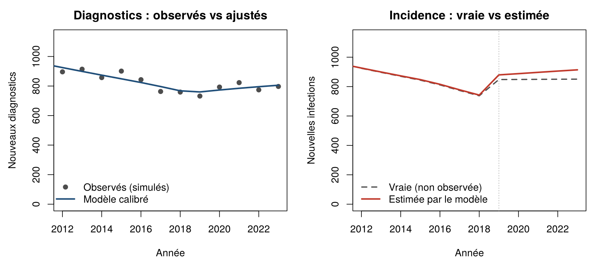
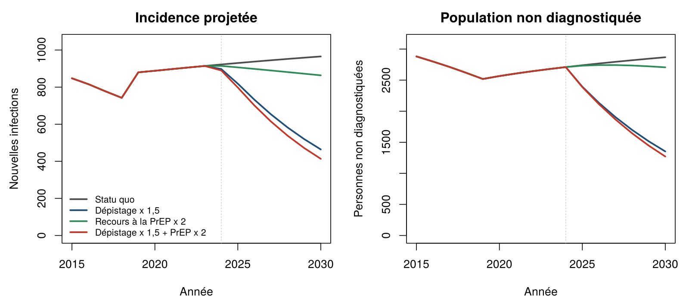

# Modèle compartimental de transmission du VIH chez les HSH

Projet personnel d'initiation à la modélisation épidémiologique. On y construit un modèle déterministe de transmission du VIH chez les hommes ayant des relations sexuelles avec des hommes (HSH). On le calibre ensuite sur des données de surveillance et on s'en sert pour comparer des scénarios de prévention.

> **Important.** Les données sont **simulées** et les paramètres sont **illustratifs**. Ce dépôt sert à montrer une méthode, pas à décrire l'épidémie réelle en France.

## Question de départ

En France, chez les HSH nés en France, l'incidence du VIH a baissé pendant plusieurs années, puis s'est stabilisée depuis 2021. La question est la suivante : un modèle calibré sur les seuls nouveaux diagnostics peut-il détecter un tel changement de dynamique et estimer l'incidence, qui, elle, n'est pas observée ?

## Le modèle

On répartit la population en cinq compartiments :

| Compartiment | Signification |
| --- | --- |
| `S` | susceptibles sans PrEP |
| `P` | susceptibles sous PrEP |
| `U` | infectés non diagnostiqués |
| `D` | diagnostiqués, pas encore sous traitement efficace |
| `T` | sous traitement, charge virale indétectable |

La force d'infection ne fait intervenir que les personnes non traitées. C'est le principe *Indétectable = Intransmissible* :

$$\lambda(t) = \beta(t)\,\frac{U + \kappa D}{N}$$

Le système d'équations est le suivant :

$$
\begin{aligned}
\frac{dS}{dt} &= \mu N - \lambda S - \rho(t) S + \omega P - \mu S \\
\frac{dP}{dt} &= \rho(t) S - \omega P - (1-\varepsilon)\lambda P - \mu P \\
\frac{dU}{dt} &= \lambda S + (1-\varepsilon)\lambda P - \delta U - \mu U \\
\frac{dD}{dt} &= \delta U - \tau D - \mu D \\
\frac{dT}{dt} &= \tau D - \mu T
\end{aligned}
$$

Le modèle repose sur trois hypothèses principales :

- **La PrEP.** Elle apparaît en 2016, l'année de son introduction en France. Son efficacité est notée ε.
- **Le taux de transmission β(t).** Il est constant par morceaux : il vaut β₁ avant 2019 et β₂ après. C'est la manière la plus simple de représenter une rupture de tendance.
- **La population.** Sa taille reste stable, car les entrées compensent les sorties de la population sexuellement active, au taux μ.

## Démarche

1. **Données simulées.** On simule le modèle avec des paramètres connus, puis on tire les diagnostics annuels de 2012 à 2023 selon une loi de Poisson.
2. **Calibration.** On estime β₁, β₂ et δ par maximum de vraisemblance de Poisson, en utilisant `optim` sur l'échelle logarithmique. Les intervalles de confiance sont de type Wald et s'obtiennent à partir de la hessienne.
3. **Vérification.** On contrôle que l'on retrouve les vraies valeurs. C'est un test d'identifiabilité.
4. **Scénarios 2024–2030.** On compare le statu quo, un dépistage 1,5 fois plus fréquent, un recours à la PrEP deux fois plus élevé, puis la combinaison des deux.

## Résultats

| Paramètre | Vraie valeur | Estimation | IC 95 % |
| --- | --- | --- | --- |
| β₁ | 0,28 | 0,280 | [0,268 ; 0,292] |
| β₂ | 0,33 | 0,338 | [0,307 ; 0,373] |
| δ | 0,30 | 0,299 | [0,274 ; 0,326] |



Les diagnostics suffisent à retrouver la rupture de 2019. On parvient aussi à reconstruire l'incidence, que l'on n'observe pas. En revanche, β₂ est estimé moins précisément que β₁, parce qu'il repose sur moins d'années de données.



Avec ces paramètres, le dépistage est le levier le plus efficace. Il agit sur le réservoir de personnes non diagnostiquées, qui porte l'essentiel de la transmission. L'effet modeste de la PrEP vient surtout du taux d'initiation choisi, qui est faible. C'est une hypothèse du modèle, pas une conclusion.

## Limites et pistes

- **Les données sont simulées.** L'étape suivante consisterait à calibrer le modèle sur les vraies données de surveillance : déclaration obligatoire, délais de diagnostic, marqueurs d'infection récente.
- **Un seul flux est observé.** Calibrer aussi sur la distribution des délais entre infection et diagnostic (CD4 au diagnostic, par exemple) améliorerait l'identifiabilité.
- **La population est homogène.** Le modèle ne distingue ni classes d'âge ni niveaux d'activité sexuelle, alors que les modèles publiés en tiennent compte.
- **La rupture est imposée.** Son année est fixée à l'avance. On pourrait l'estimer, ou utiliser un β(t) plus souple, par exemple sous forme de spline.
- **L'incertitude est sous-estimée.** Une approche bayésienne (MCMC) ou de type ABC rendrait mieux compte de l'incertitude sur tous les paramètres.

## Utilisation

```bash
Rscript run_all.R
```

Le projet utilise R 4.x et le package `deSolve`, que l'on installe avec `install.packages("deSolve")`. Les figures sont écrites dans `figures/` et les tableaux dans `output/`.

```
R/model.R        équations et simulation
R/parameters.R   paramètres illustratifs et état initial
R/calibrate.R    données simulées et maximum de vraisemblance
R/scenarios.R    projections
run_all.R        point d'entrée
```

## Références

- Cambiano V. et al. (2023). *Lancet HIV*, 10, e713–e722. Stratégies de prévention combinée chez les HSH au Royaume-Uni.
- De Bellis A. et al. (2025). *Nature Communications*, 16, 3527. Impact d'un traitement curatif potentiel sur la transmission du VIH.
- Khurana N. et al. (2018). *JAIDS*, 78, 399–405. Soins du VIH et efficacité de la PrEP aux États-Unis.
- Shah M. et al. (2016). *Clinical Infectious Diseases*, 62, 220–229. Dépistage et maintien dans le soin aux États-Unis.
